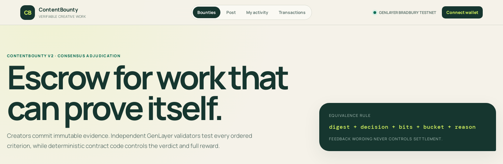
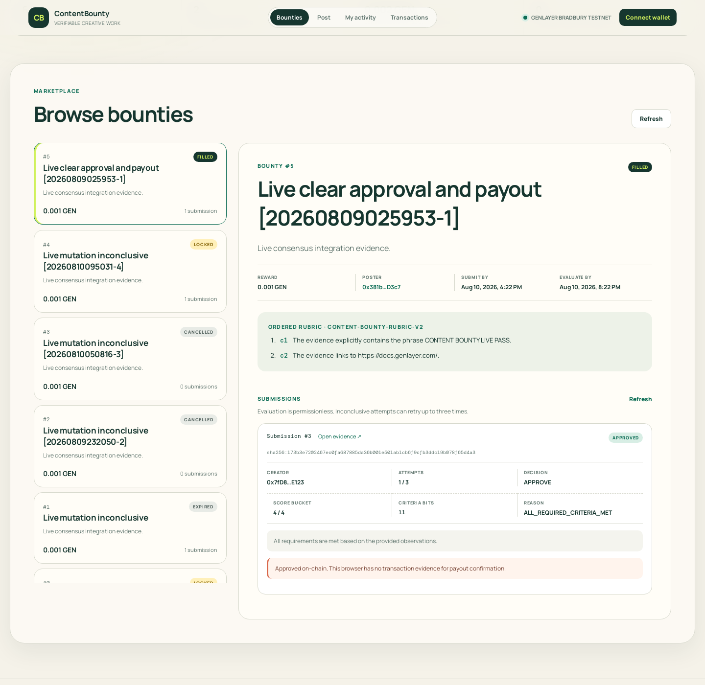
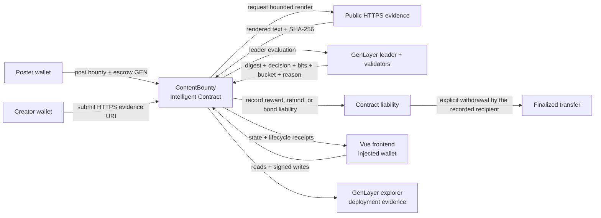

# ContentBounty

**Escrow for work that can prove itself.**

ContentBounty is a marketplace for creative work on the GenLayer network. A
poster defines an ordered rubric and escrows a GEN reward. A creator submits
public evidence. GenLayer validators evaluate every required criterion,
while deterministic contract logic controls the verdict and settlement.

This is not an off-chain review dashboard. The contract records the bounty,
evidence commitment, submission lifecycle, consensus result, challenge state,
and deterministic settlement. An evaluation can approve a provisional result,
but only the explicit `claim_reward` path records the creator reward after
the dispute window, and only the explicit `withdraw_reward` path releases it.

[](https://contentbounty.vercel.app)
[](https://github.com/unifyWeb3/contentbounty/actions/workflows/ci.yml)
[](https://docs.genlayer.com/)
[](https://vuejs.org/)
[](https://www.python.org/)
[](LICENSE)

## What changed in v2.3 (this milestone)

Baseline for the comparison: tag `baseline-accepted` (the accepted v2.2
deployment, Bradbury `0x7F73e10059D0C669c2d2fe3FA716312587aC87c8`).
Full evidence: [`docs/MILESTONE-1.md`](docs/MILESTONE-1.md).

| Change | What it means |
|---|---|
| **Closed-set verdicts** | The contract no longer stores any model prose. `Submission.feedback` and `Challenge.proposed_feedback` are gone; every persisted verdict field is either recomputed by every validator or derived by deterministic contract code. A new `verdict_code` is a closed set, and `get_submission_verdict` publishes the per-criterion result and the rubric digest. |
| **Pull-based settlement** | No state transition moves value any more. `claim_reward`, `cancel_bounty`, `expire_bounty`, `finalize_challenge` and `timeout_challenge` only *record* a liability. Three new methods — `withdraw_reward`, `withdraw_refund`, `withdraw_bond` — perform the transfers, each exactly once and each authorised against the recorded recipient. |
| **Published escrow accounting** | `get_escrow_accounting()` publishes every liability class the contract holds. Its sum is the native balance the contract must hold and can be compared with the observed balance. |
| **Poster-declared dispute window** | The 48-hour challenge window was a hard-coded constant that was invisible in the bounty's own record. It is now a poster-declared parameter (300 s … 172 800 s), stored on the bounty, copied into `challenge_deadline` at approval, and shown to the creator before they submit. |
| **Fixed: overturned approvals** | An upheld challenge used to leave a *rejected* submission claiming `criteria_bits = 11` and a perfect score. The overturned approval is now cleared and the verdict is `CHALLENGE_UPHELD`. |
| **Fixed: unresolvable challenges** | A challenge whose evidence source changed after filing made `review_challenge` revert instead of returning `INCONCLUSIVE`, so the challenge could only be resolved 48 hours later. `DIGEST_MISMATCH` is now a declared error class. |
| **Prompt-anchor neutralisation** | Untrusted evidence can no longer contain the contract's own prompt anchors. The SHA-256 commitment still covers the exact published bytes. |
| **One status → action rule in the interface** | The interface no longer re-implements contract rules. One pure function decides which actions are offered, and its vocabulary is checked against the status constants parsed out of the contract source. This fixed a case where the interface offered an action the contract rejects. |

## Live deployment (current v2.3)

Source commit `6565064`, SHA-256
`0f9e045a462992e226fa69203049b2e9ea108cd9040c097f0c7449bb3cc4c0a5`
(81 035 bytes, readable source). The deployed bytes were read back with
`gen_getContractCode` and are **byte-identical** to `contracts/content_bounty.py`.

**`0x12F6A5654fd0496951cd11976D2ebFa2cB4417Da`** on **GenLayer Studionet
(chain 61999)** — deployment
[`0xbb3d4e6681db88931c2d1e19ccafc6daf10ffd48bd691850658cdc98782f18a2`].

Read this honestly before you use it:

* **Studionet state is temporary.** The official GenLayer network reference
  lists Studionet as a hosted development environment whose state resets are
  expected. This deployment is proof of work, not a permanent home.
* **GEN on Studionet is faucet-simulated and is worth nothing.**
  `sim_fundAccount` mints the balances. The live proof shows that value moves
  through the escrow and back out through the withdrawal path; it does not
  show money.
* **The accepted v2.2 deployment is still live on Bradbury** at
  `0x7F73e10059D0C669c2d2fe3FA716312587aC87c8` (chain 4221, persistent), and
  it is unchanged. A persistent v2.3 deployment on Bradbury needs one faucet
  claim in a browser, which is a human step.

| Surface | Link |
|---|---|
| Current v2.3 contract | [`0x12F6A5654fd0496951cd11976D2ebFa2cB4417Da`](https://explorer-studio.genlayer.com/address/0x12F6A5654fd0496951cd11976D2ebFa2cB4417Da) |
| v2.3 deployment transaction | [`0xbb3d4e66...f18a2`](https://explorer-studio.genlayer.com/tx/0xbb3d4e6681db88931c2d1e19ccafc6daf10ffd48bd691850658cdc98782f18a2) |
| Milestone-1 evidence | [docs/MILESTONE-1.md](docs/MILESTONE-1.md) |
| Accepted v2.2 contract (Bradbury, persistent) | [`0x7F73e10059D0C669c2d2fe3FA716312587aC87c8`](https://explorer-bradbury.genlayer.com/address/0x7F73e10059D0C669c2d2fe3FA716312587aC87c8) |
| v2.2 deployment transaction | [`0x7b5ef343...8532`](https://explorer-bradbury.genlayer.com/tx/0x7b5ef343bffa78cc0f735ce0c7e41488b288a9bbe4c72d417a36f70349f18532) |
| v2.2 deployment proof | [Bradbury v2.2 proof](docs/proofs/bradbury-v22-deployment-proof.json) |
| Source | https://github.com/unifyWeb3/contentbounty |
| Historical v2.1.1 contract (archived) | [`0x0d997CF8E3E8b4b7166ED2e0713F7F6927Ba4c04`](https://explorer-bradbury.genlayer.com/address/0x0d997CF8E3E8b4b7166ED2e0713F7F6927Ba4c04) |
| Historical proof | [Bradbury proof v1](docs/proofs/bradbury-persistent-proof-v1.json) |
| X walkthrough | [Watch on X](https://x.com/i/status/2087119821921993214) |
| YouTube demo | [Watch on YouTube](https://youtu.be/wv_5xmYamDU) |

## How it works

| Operation | What happens on GenLayer |
|---|---|
| `post_bounty(...)` | The poster funds a reward, defines deadlines and the dispute window, and commits an ordered rubric with its digest. |
| `submit_content(bounty_id, uri)` | Consensus renders an allowlisted HTTPS source, normalizes it, checks the creator's claim tag, and stores its SHA-256 commitment. |
| `evaluate_submission(submission_id)` | A leader evaluates the rubric and validators independently repeat the evidence pipeline. Approval becomes `APPROVED_PENDING`; no reward moves. |
| `challenge_submission(...)` | A non-creator challenger posts fixed-reason evidence with the exact challenge bond during the dispute window. The bounty poster may challenge. |
| `review_challenge(challenge_id)` | A second consensus round proposes `UPHOLD`, `DISMISS`, or `INCONCLUSIVE`; it never moves funds. |
| `finalize_challenge(...)` / `timeout_challenge(...)` | Deterministic logic settles a reviewed or timed-out challenge and records who may withdraw the bond. |
| `claim_reward(submission_id)` | After the dispute window and with no active challenge, the creator alone records the reward as withdrawable and the bounty becomes `FILLED`. **No value moves.** |
| `withdraw_reward(submission_id)` | The creator pulls the recorded reward. Exactly once, creator only. |
| `withdraw_refund(bounty_id)` | The poster pulls a recorded refund from a cancelled or expired bounty. Exactly once, poster only. |
| `withdraw_bond(challenge_id)` | The recorded bond recipient pulls the bond. Exactly once, recipient only. |
| Rejected result | The submission is terminal and remains unpaid. |
| Inconclusive result | Fetch, parser, or digest uncertainty can be retried without misclassifying the creator. |
| `cancel_bounty(...)` | The poster can record a refund for an untouched open bounty. The refund is pulled separately. |
| `expire_bounty(...)` | Anyone can record a refund after the evaluation deadline if no provisional winner or active challenge exists. |

Core equivalence rule:

```text
evidence SHA-256 + decision + criteria bits + score bucket + reason code + claim-tag state
```

Feedback wording is not part of equivalence because no model wording is stored
at all. The verdict is a closed set derived by deterministic contract code.
The model never chooses the payment amount or recipient.

## GenLayer integrations

| Integration | Where it is used |
|---|---|
| Intelligent Contract on Studionet and Bradbury | Escrow, bounty state, submissions, consensus results, transfers, and refunds. |
| `gl.nondet.web.render` | Retrieves bounded public evidence during submission and evaluation. |
| `gl.nondet.exec_prompt` | Extracts observations and judges every ordered rubric criterion. |
| `gl.vm.run_nondet_unsafe` | Runs the leader result against an independent validator policy that re-renders the evidence and re-runs the judgment. |
| `emit_transfer` | Moves value only from `withdraw_reward`, `withdraw_refund` and `withdraw_bond`. No state transition emits a transfer. |
| `Keccak256` | Derives the domain-separated pre-submission claim tag; no ECDSA recovery primitive is assumed. |
| `gl.message_raw["datetime"]` | Supplies the authoritative transaction timestamp used for all deadlines. |
| GenLayer explorer | Provides public contract and transaction lifecycle evidence. |
| `genlayer-js` | Connects the Vue frontend to reads and externally signed wallet writes. |

## Verified deployments

**Current v2.3** (Studionet, closed-set verdicts, pull-based settlement):

| Surface | Details |
|---|---|
| Contract | [`0x12F6A5654fd0496951cd11976D2ebFa2cB4417Da`](https://explorer-studio.genlayer.com/address/0x12F6A5654fd0496951cd11976D2ebFa2cB4417Da) Studionet 61999 |
| Deployment tx | [`0xbb3d4e66...f18a2`](https://explorer-studio.genlayer.com/tx/0xbb3d4e6681db88931c2d1e19ccafc6daf10ffd48bd691850658cdc98782f18a2) `FINALIZED/MAJORITY_AGREE` |
| Source | commit `6565064`, sha256 `0f9e045a...cc4c0a5` (81 035 bytes, readable, `py-genlayer:1jb45...`) |
| Byte identity | `gen_getContractCode` read back and compared with the repository file: **identical** |
| Methods | 24 (11 view / 13 write), `genvm-lint check` |
| Tests | 84 direct-mode (67 before, 17 new) and 111 frontend (97 before, 14 new) |
| Milestone evidence | [docs/MILESTONE-1.md](docs/MILESTONE-1.md) |

**Accepted v2.2** (Bradbury, delayed settlement, `APPROVED_PENDING` + 48 h window).
This is the earlier accepted version and it is unchanged:

| Surface | Details |
|---|---|
| Contract | [`0x7F73e10059D0C669c2d2fe3FA716312587aC87c8`](https://explorer-bradbury.genlayer.com/address/0x7F73e10059D0C669c2d2fe3FA716312587aC87c8) Bradbury 4221 |
| Deployment tx | [`0x7b5ef343...8532`](https://explorer-bradbury.genlayer.com/tx/0x7b5ef343bffa78cc0f735ce0c7e41488b288a9bbe4c72d417a36f70349f18532) `FINALIZED/AGREE` |
| Source | commit `2e35764`, sha256 `b5e89cf0...33df36a` (minified 52 237 bytes) |
| Deployment proof | [Bradbury v2.2 proof](docs/proofs/bradbury-v22-deployment-proof.json) |

**Historical v2.1.1** (immediate settlement, no challenge window):

| Scenario | On-chain result | Evidence |
|---|---|---|
| Bounty `#0`, submission `#0` | `REJECTED`, `CRITERIA_NOT_MET` | [Evaluation transaction](https://explorer-bradbury.genlayer.com/tx/0xd3d6cafc07bbe23725fc742dab66e6d43d0b7c2ba36c7d19082cb7ad5657df33) |
| Bounty `#4`, submission `#2` | `INCONCLUSIVE`, `DIGEST_MISMATCH` | [Evaluation transaction](https://explorer-bradbury.genlayer.com/tx/0x0708c8cb1c4f287292844b8e4f10ae27f4f45963176692d9031d8dbd3ef0b1aa) |
| Bounty `#5`, submission `#3` | `APPROVED` (immediate), `ALL_REQUIRED_CRITERIA_MET` | [Evaluation transaction](https://explorer-bradbury.genlayer.com/tx/0x5eca4c1ab3d15e7586aca3b32aabf035beba9917c310ad78da442b239ac1c227) |

Historical links are archived at [`0x0d997...`](https://explorer-bradbury.genlayer.com/address/0x0d997CF8E3E8b4b7166ED2e0713F7F6927Ba4c04) and do not demonstrate the delayed-claim machine.

## Verification path

1. Open https://contentbounty.vercel.app — confirm it loads a bundle containing
   `0x12F6A5654fd0496951cd11976D2ebFa2cB4417Da` and not the historical addresses.
2. Open the **current v2.3 contract** on the Studionet explorer; check
   `get_allowed_sources`, `get_claim_tag` and `get_escrow_accounting`.
3. Open the **accepted v2.2 contract** `0x7F73...` on the Bradbury explorer.
4. Read the deployed v2.3 source back and compare it with the repository file:

```bash
curl -s -X POST https://studio.genlayer.com/api -H 'Content-Type: application/json' \
  -d '{"jsonrpc":"2.0","id":1,"method":"gen_getContractCode","params":["0x12F6A5654fd0496951cd11976D2ebFa2cB4417Da"]}'
sha256sum contracts/content_bounty.py
```

5. Read [docs/MILESTONE-1.md](docs/MILESTONE-1.md) for the claim -> commit ->
   test -> live transaction table, and `state/AUDIT.md` for the baseline audit.

## Product screens





The interface deliberately separates an approved on-chain result from payout
confirmation observed by the current browser. The persistent balance proof is
linked above and is independently checked against the finalized recipient delta.

## Architecture



No custodial backend, private judge, or frontend-held signing key controls the
outcome. The Intelligent Contract is the source of truth.

## Lifecycle

| Bounty status | Meaning |
|---|---|
| `OPEN` | Funded with no provisional or final winner. It may be untouched, or reopened after an upheld challenge; submission and cancellation eligibility still follow the stored deadlines and counts. |
| `LOCKED` | At least one submission remains evaluable, or a provisional winner is awaiting settlement. Poster cancellation is disabled. |
| `FILLED` | A consensus-approved submission won. The reward is recorded as withdrawable and the creator pulls it. |
| `CANCELLED` | An untouched bounty was cancelled. A refund is recorded and the poster pulls it. |
| `EXPIRED` | The deadline passed without a winner. A refund is recorded and the poster pulls it. |

Submissions move through `PENDING`, `APPROVED_PENDING`, `APPROVED`, `REJECTED`,
`INCONCLUSIVE`, and `SUPERSEDED`. `APPROVED_PENDING` means the consensus
evaluation passed, but the reward is still escrowed during the dispute window.
Only `claim_reward` changes it to final `APPROVED`, and `claim_reward` only
records the reward; `withdraw_reward` moves it. Challenges use exactly
`OPEN`, `UPHELD`, `DISMISSED`, and `TIMED_OUT`; `active_challenge_id=0` means
there is no active challenge, and the bond is recorded for withdrawal when the
challenge settles. Inconclusive evaluations and challenge reviews can retry
only within their bounded attempt/deadline rules.

The dispute window is a poster-declared parameter, stored on the bounty when it
is posted and copied into `challenge_deadline` at approval. The contract
accepts 300 to 172 800 seconds. The creator sees the exact window on the
bounty before submitting.

## Repository layout

```text
contracts/                  GenLayer Intelligent Contract
frontend/                   Vue product with injected wallet signing
hosting/live-evidence/      Public canonical evidence Worker
scripts/                    Deployment, proof, recovery, and safety tools
tests/direct/               GenLayer Direct Mode contract tests
tests/js/                   Lifecycle, proof, network, and recovery tests
tests/unit/                 Evidence preparation tests
docs/MILESTONE-1.md         Milestone-1 claim -> commit -> test -> live table
docs/assets/                Product screenshots
docs/proofs/                Sanitized proofs and published evidence sources
state/                      Baseline audit, milestone plan, design, decision log
submission/                 The Changes & Improvements text
```

## Run locally

Requirements: Node.js 22, npm, and Python 3.12.

```bash
git clone https://github.com/unifyWeb3/contentbounty.git
cd contentbounty
npm ci
npm ci --prefix frontend
cp frontend/.env.example frontend/.env
npm --prefix frontend run dev
```

Production build against the current v2.3 deployment:

```bash
VITE_GENLAYER_NETWORK=studionet VITE_CONTRACT_ADDRESS=0x12F6A5654fd0496951cd11976D2ebFa2cB4417Da npm run build:frontend
npm run verify:frontend-bundle
```

The production build fails closed if required network or address configuration is missing or malformed. The tracked address is the live v2.3 Studionet deployment; the accepted v2.2 Bradbury deployment is `0x7F73...` and the historical `0x0d997...` is archived. To build against the persistent Bradbury deployment instead, use `VITE_GENLAYER_NETWORK=testnetBradbury` and the v2.2 address.

## Prepare evidence

Evidence must be UTF-8 raw text at a stable HTTPS URI. After line-ending and
outer-whitespace normalization, it must contain 1 to 16,000 characters.

```bash
.venv/bin/python scripts/prepare_evidence.py --uri https://raw.githubusercontent.com/owner/repository/main/evidence.txt --file evidence.txt --write-canonical canonical-evidence.txt
```

Submission consensus remains authoritative and stores the renderer-derived
digest. Before publishing, the creator must place the displayed claim tag in the
source. A later content change becomes `DIGEST_MISMATCH`; removing the tag is a
deterministic `CLAIM_TAG_MISSING` rejection before any LLM evaluation.

## Consensus security and provenance

### Claim tag

For a selected bounty and wallet, the pure `get_claim_tag(bounty_id,
creator_address)` view derives a readable token from a domain separator, version,
chain ID, contract address, bounty ID, and creator address. The current runtime
provides an Ethereum-compatible `Keccak256`, so the contract uses an 80-bit
hexadecimal prefix in the form `cb-<20 hex characters>`. The frontend obtains
the same canonical value from the view before publication and offers a copy
action. Eighty bits keeps the birthday-collision probability around 4e-13 even
across one million tags, while keeping the token short enough to place in a
post.

The tag is a practical control signal: if the exact token is present in the
normalized rendered source, the submitting wallet had sufficient control of the
publishing surface to place it at render time. The deterministic check is
case-insensitive and requires token boundaries. It is performed by consensus
before submission state is allocated and again before any evaluation prompt.

The tag does not prove legal authorship, copyright ownership, the real-world
identity behind a wallet, originality, truthfulness of claims, or permanent
control of a source. It is not a legal or cryptographic authorship attestation.
Platforms where a post cannot be edited must receive the tag before publication;
an omitted tag cannot be repaired by this implementation. There is no
post-publication or same-submission repair path in this scope.

### Supported source surfaces

The deterministic source policy accepts only `github.com`,
`raw.githubusercontent.com`, `gist.github.com`, `mirror.xyz`, `hackmd.io`,
`medium.com`, and `substack.com` plus valid Substack subdomains. URLs must be
canonical HTTPS, contain no credentials or fragments, and use an exact allowed
host. The allowlist constrains sources the GenVM renderer is prepared to handle;
it is not proof of ownership or authorship. X/Twitter is intentionally excluded
until a reliable, deterministic renderer path is established.

### Challenges and delayed settlement

An approval enters `APPROVED_PENDING` and records the dispute deadline, which
is the poster-declared window stored on the bounty (300 to 172 800 seconds).
The bounty remains `LOCKED`, no competitor is superseded, and no creator reward
is transferred. A challenge uses one fixed reason code:

`NO_SOURCE_CONTROL`, `AUTHORSHIP_DISPUTE`, `RIGHTS_OR_PLAGIARISM`,
`FALSE_OR_MISLEADING_CLAIM`, `SOURCE_TAMPERED`, or
`RUBRIC_EVALUATION_ERROR`.

The exact integer bond is:

```text
max(reward * 500 / 10000, 0.0001 GEN)
```

The submission creator cannot challenge their own submission; the bounty poster
may challenge because the poster is an economically interested party who still
needs a permissionless way to dispute an incorrect approval. An upheld or timed-
out challenge records the bond as withdrawable by the challenger and rejects
only an upheld submission. A dismissed challenge records the bond as
withdrawable by the submission creator as compensation for a frivolous
challenge, while leaving the approved result claimable after the original
deadline. Every bond is recorded for withdrawal exactly once, and only the
recorded recipient can withdraw it.

`review_challenge` is a nondeterministic proposal round. It independently
renders and commits both sources, checks the stored digest and claim tag, and
only then uses bounded prompts with source text framed as untrusted data.
`finalize_challenge` is a separate deterministic settlement round; review output
cannot itself move funds. Leader/validator disagreement reverts without a
proposal or bond movement. No model wording is stored at all, so nothing
outside the equivalence set is persisted.

Challenge review can time out either after three agreed inconclusive attempts or
after 48 hours from challenge creation. The elapsed-time path is mandatory so a
validator disagreement cannot lock escrow forever. Timeout intentionally fails
open to the already consensus-approved result: the challenge bond returns to the
challenger, the active challenge clears, and the creator may claim once the
original challenge deadline has elapsed.

`claim_reward` is the only path that can make a creator reward due. It checks
the creator caller, deadline, active challenge, provisional winner, bounty lock,
and one-time claim, updates all settlement fields, marks the bounty `FILLED`,
and supersedes remaining pending competitors. It does not emit a transfer.
`withdraw_reward` is the only path that moves the reward, and it only pays the
creator who owns the submission, once.

### Deferred identity work

This implementation deliberately does not include a wallet-to-platform handle
registry, registration proofs, source generations, reverse indexes, or a signed
identity attestation. The claim tag and allowlist establish practical source
control evidence only. A future registry can add authoritative platform/handle
binding after its platform-specific proof model and deterministic renderer
requirements are specified.

## Test and verify

```bash
python3 -m venv .venv
.venv/bin/pip install -r requirements.txt
npm run lint:contract
npm run check:contract
npm run test:contract
npm run test:evidence
npm run test:network
npm run test:lifecycle
npm run test:hosting
npm --prefix frontend test
npm run build:frontend
npm run verify:live-proof
```

Online proof verification is separate and read-only:

```bash
npm run verify:live-proof:online
```

## Security and limitations

- The frontend uses an injected wallet and never requests or stores a private
  key.
- Before every write, the frontend verifies the GenLayer execution state and
  the configured consensus contract identity.
- An accepted transaction is never presented as finalized.
- Payout confirmation requires a finalized withdrawal execution and a
  recipient balance delta; an evaluation approval alone is never payment, and
  a recorded liability is never presented as a transfer.
- No model wording is stored on chain, so the interface never presents
  unverified text as a consensus result. It presents the closed-set verdict and
  the per-criterion bits that the validators agreed on.
- A missing claim tag is a deterministic rejection with no LLM call; changed or
  otherwise unverifiable evidence remains an `INCONCLUSIVE` path where the
  contract cannot make a deterministic claim-tag decision.
- The challenge mechanism disputes plagiarism, rights, false claims, source
  control, or evaluation error; it does not turn an LLM judgment into legal
  adjudication.
- Bradbury and Studionet are public testnets. Tests and live proof do not
  replace a formal security audit.
- Bradbury shares chain ID `4221` with another GenLayer network. Wallets that
  cannot switch automatically must use the Bradbury RPC configuration.
- The v2.3 milestone deployment is on Studionet, whose state is temporary and
  whose GEN is faucet-simulated. It proves the escrow mechanics, not money.
- A persistent Bradbury deployment of v2.3 needs one faucet claim in a browser;
  the official faucet is protected by a captcha and cannot be automated.
- On Studionet, a reverted payable call credits the contract without a
  matching debit. The contract's own liability accounting is exact, but the
  raw native balance can exceed it by the value of reverted calls. This was
  measured to the wei and is recorded in `docs/MILESTONE-1.md` §4.

## Deployment status

**Current v2.3** is deployed and finalized at `0x12F6A5654fd0496951cd11976D2ebFa2cB4417Da` (Studionet 61999, deployment tx `0xbb3d4e66...f18a2`, source `6565064`/`0f9e045a...`). The deployed bytes were read back with `gen_getContractCode` and are byte-identical to `contracts/content_bounty.py`. The public frontend at https://contentbounty.vercel.app serves this address; the bundle verifier confirms the address is present and the historical ones are absent.

**Accepted v2.2** is still deployed and finalized at `0x7F73e10059D0C669c2d2fe3FA716312587aC87c8` (Bradbury 4221, tx `0x7b5ef343...8532`, source `2e35764`/`b5e89cf...`). It is unchanged. The checked-in v2.1.1 proof remains valid historical evidence but is not evidence for v2.2 or v2.3.

The full live proof for v2.3, with every transaction hash and the observed
balances, is in [`docs/MILESTONE-1.md`](docs/MILESTONE-1.md).

## Documentation

- [Milestone-1 evidence: claim -> commit -> test -> live transaction](docs/MILESTONE-1.md)
- [Milestone-1 Changes & Improvements text](submission/milestone-text.md)
- [Baseline audit, milestone plan and design](state/AUDIT.md)
- [ContentBounty v2 specification](docs/CONTENT_BOUNTY_V2_SPEC.md)
- [Live consensus testing and recovery](docs/LIVE_CONSENSUS_TESTING.md)
- [Persistent Bradbury proof](docs/proofs/bradbury-persistent-proof-v1.json)
- [Frontend safety model](frontend/README.md)
- [Historical v2.1.1 Evidence Worker](hosting/live-evidence/README.md)
- [Historical implementation log through v2.1.1](IMPLEMENTATION_LOG.md)

`AUDIT_REPORT.md` covers the historical pre-v2 commit and is not a report on the
current verified deployment. The baseline audit of the accepted v2.2 deployment
is in `state/AUDIT.md`.

## License

[MIT](LICENSE) Copyright 2026 unifyWeb3
